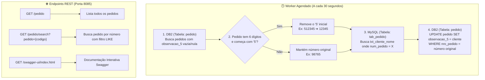

# 📦 Api-Pedidos-ERP (info-nf)

API REST e Worker em segundo plano desenvolvido em **Java 21** com **Spring Boot** para integração e sincronização contínua de pedidos entre o banco de dados online (**MySQL**) e o sistema de ERP Promob (**IBM DB2**).

---

## 🎯 Objetivo do Projeto

1. **Sincronização Automática em Background**: Identifica novos pedidos inseridos no ERP (DB2), busca o respectivo cliente no banco online (MySQL) e preenche automaticamente o campo de observação no ERP.
2. **Consulta e Pesquisa de Pedidos**: Fornece endpoints REST protegidos por autenticação JWT para consultar e buscar pedidos.
3. **Multi-DataSource**: Gerencia conexões ativas simultâneas com dois bancos de dados de tecnologias e redes distintas.

---

## 🏗️ Arquitetura e Fluxo de Dados



---

## 🛠️ Tecnologias Utilizadas

* **Linguagem**: Java 21 LTS
* **Framework**: Spring Boot 4.1.2
* **Acesso a Dados**: Spring Data JPA / Spring JDBC (`JdbcTemplate`) com padrão Multi-DataSource
* **Bancos de Dados**:
  * **IBM DB2** (Driver `com.ibm.db2:jcc`) — Banco do ERP
  * **MySQL** (Driver `mysql-connector-j`) — Banco de pedidos online
* **Segurança**: Spring Security + Autenticação JWT (`jwt-package`)
* **Documentação de API**: SpringDoc OpenAPI / Swagger UI
* **Produtividade**: Lombok
* **Agendamento**: Spring `@EnableScheduling` + `@Scheduled`

---

## 📋 Mapeamento de Tabelas e Regras de Negócio

### 1. Banco MySQL (Site / Pedidos Online)
* **Tabela**: `tab_pedido`
* **Campos Utilizados**:
  * `num_pedido`: Número do pedido (5 dígitos)
  * `txt_cliente_nome`: Nome/Razão Social do cliente

### 2. Banco IBM DB2 (ERP Promob / Bartz)
* **Tabela**: `pedido`
* **Campos Utilizados**:
  * `nro_pedido`: Código do pedido no ERP
  * `observacao_5`: Campo de observação preenchido no formato `Nome Cliente: [nome do cliente]` recuperado do MySQL

### 3. Regra dos 6 Dígitos
Alguns pedidos chegam ao ERP com 6 dígitos iniciando com o número `5` (exemplo: `512345`), enquanto no MySQL eles estão cadastrados com 5 dígitos (`12345`).
* O sincronizador detecta se o pedido possui 6 dígitos e inicia com `5`.
* Caso positivo, remove o `5` inicial para fazer a busca do cliente no MySQL.
* O `UPDATE` no DB2 é realizado utilizando o número original do ERP (`512345`), garantindo a consistência.

---

## ⚙️ Configuração de Ambiente (.env)

O projeto lê as variáveis de ambiente a partir de um arquivo `.env` localizado na raiz do projeto ou na pasta da aplicação:

```properties
# ===============================
# BANCO 1: DB2 (ERP)
# ===============================
URL_DB2=jdbc:db2://192.168.1.10:50000/NOME_BANCO
USERNAME_DB2=seu_usuario_db2
PASSWORD_DB2=sua_senha_db2
DB_PORT=8085

# ===============================
# BANCO 2: MySQL (Site)
# ===============================
URL_MYSQL=jdbc:mysql://servidor-mysql:3306/banco_online?useSSL=false&serverTimezone=America/Sao_Paulo
USERNAME_MYSQL=seu_usuario_mysql
PASSWORD_MYSQL=sua_senha_mysql

# ===============================
# SEGURANÇA E JWT
# ===============================
jwt.secret-key=chave_secreta_longa_e_segura
jwt.excluded-paths=/public/**, /auth/login, /swagger-ui/**, /swagger-ui.html, /v3/api-docs/**, /actuator/**
jwt.expiration-time=43200000 

USERNAME_LOGIN=admin
PASSWORD_LOGIN=$2a$12$...
```

---

## 🚀 Como Executar o Projeto

### Pré-requisitos
* **Java JDK 21** instalado e configurado no `PATH`
* Conectividade de rede com os servidores do DB2 e MySQL

### Em Ambiente de Desenvolvimento

```powershell
# Acesse o diretório do módulo
cd info-nf

# Inicie a aplicação com o Maven Wrapper
.\mvnw.cmd spring-boot:run
```

A aplicação iniciará na porta configurada (padrão: `8085`).

---

## 📦 Publicação em Produção (Servidor)

### 1. Gerar o arquivo `.jar` executável

```powershell
cd info-nf
.\mvnw.cmd clean package -DskipTests
```

O arquivo final será gerado em:
📁 `info-nf/target/info-nf-0.0.1-SNAPSHOT.jar`

### 2. Estrutura recomendada no servidor

Crie uma pasta no servidor (ex: `C:\Servicos\Api-Pedidos\`) contendo:

```text
C:\Servicos\Api-Pedidos\
 ├── api-pedidos.jar   (o arquivo .jar gerado)
 ├── .env              (arquivo com as credenciais)
 └── iniciar.bat       (script de inicialização)
```

Conteúdo do `iniciar.bat`:

```bat
@echo off
cd /d "C:\Servicos\Api-Pedidos"
java -jar api-pedidos.jar >> logs.txt 2>&1
```

### 3. Agendador de Tarefas do Windows (Task Scheduler)

Para inicialização automática no boot do servidor:
1. Abra o **Agendador de Tarefas** (`taskschd.msc`).
2. Crie uma nova tarefa:
   * **Geral**: Marque *"Executar estando o usuário conectado ou não"* e *"Executar com privilégios mais altos"*.
   * **Disparadores**: Selecione *"Ao inicializar o sistema"*.
   * **Ações**: 
     * Programa/script: `C:\Servicos\Api-Pedidos\iniciar.bat`
     * Iniciar em (obrigatório): `C:\Servicos\Api-Pedidos\`
   * **Configurações**: Desmarque *"Interromper a tarefa se ela for executada por mais de..."*.

---

## 📌 Documentação da API e Endpoints

Com a aplicação rodando, acesse a documentação interativa pelo Swagger:
👉 **http://localhost:8085/swagger-ui/index.html**

| Método | Endpoint | Descrição |
|---|---|---|
| `GET` | `/pedido` | Retorna lista de pedidos cadastrados |
| `GET` | `/pedido/search?pedido={numero}` | Busca pedidos por código/número parcial |
| `GET` | `/actuator/health` | Verificação do status de saúde da aplicação |

---

## 📄 Licença e Manutenção

Projeto interno desenvolvido para integração de sistemas ERP / E-commerce Bartz Móveis.

